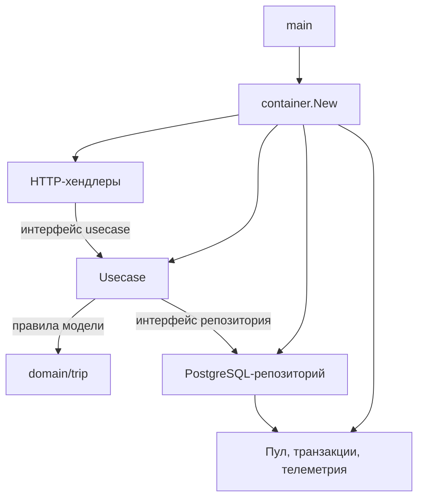
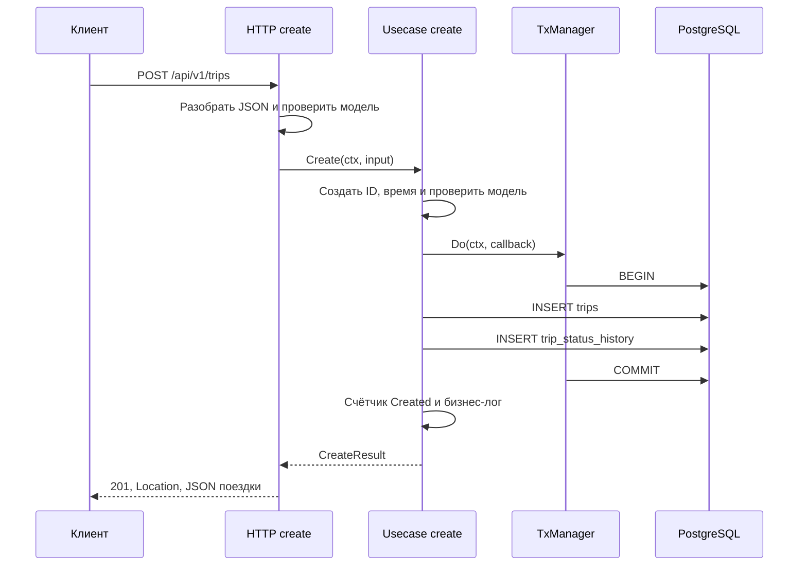
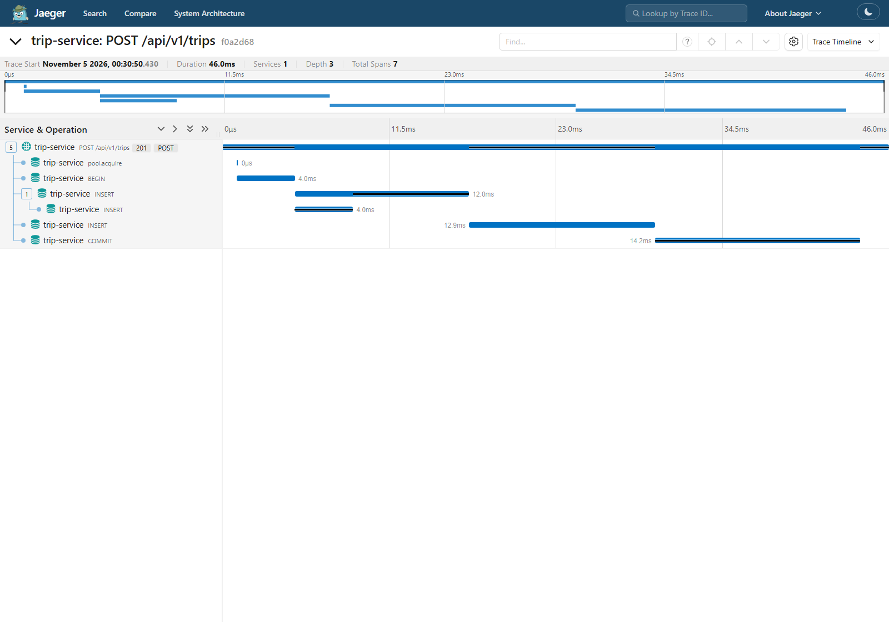
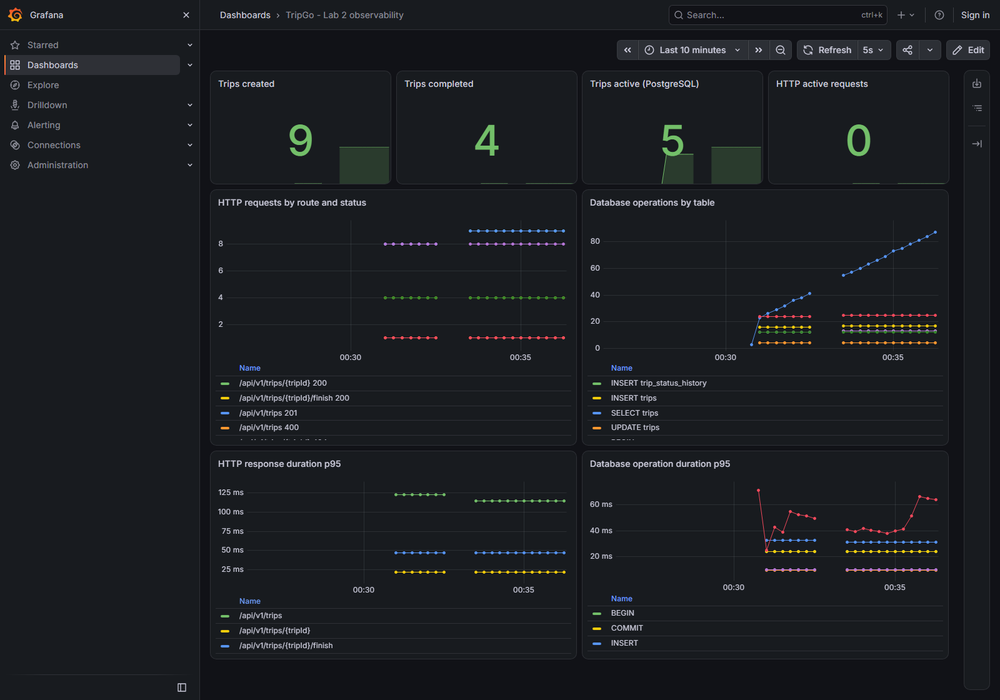

# TripGo — подробная документация лабораторной работы №2

## 1. Для чего нужен этот документ

Это разбор реализации второй лабораторной для изучения кода и подготовки к
защите. Он объясняет устройство слоёв, путь запроса, транзакции, тесты и
наблюдаемость. Описание относится к текущему коду ветки `homework/02`.

Исходное условие опубликовано в репозитории курса.
[Условие второй лабораторной](https://github.com/course-go-autumn-2026/course/tree/main/homework/tasks/02-architecture-and-observability).

Команды повседневного запуска собраны в README. Результаты выполненных
проверок и скриншоты находятся в `docs/lab2/README.md`.

## 2. Что изменилось после первой работы

В первой работе сервис получил создание, чтение и завершение поездки,
PostgreSQL, историю статусов, транзакции, идемпотентность и Docker.
Во второй работе эти операции получили отдельные слои, доменные правила,
автоматические проверки и телеметрию.

| Первая работа | Текущее расположение | Ответственность |
|---|---|---|
| Сборка зависимостей в `main` | `internal/container/container.go` | Создать объекты и связать их |
| Модели и сервис в `internal/trip` | `internal/domain/trip`, `internal/model`, `internal/usecase/trip` | Правила модели и сценарии действий |
| Общий HTTP-хендлер в `internal/httpapi` | `internal/http/trip/create`, `get`, `finish` | Разобрать запрос и сформировать ответ |
| Разбор ошибок внутри хендлера | `internal/http/domainerror` | Перевести ошибку в Problem |
| PostgreSQL в `internal/postgres` | `internal/repository/trip`, `internal/infra/postgres` | SQL, пул, транзакции и инструментирование |
| Ручные подмены usecase-зависимостей | `contract.go` и generated `mocks_test.go` | Проверять взаимодействие через gomock |
| `go vet` в `make lint` | `.golangci.yml` | Проверять ошибки, слои и форматирование |

В точке запуска используется имя `cmd/trip-service`, чтобы команды проекта
и Dockerfile продолжали обращаться к знакомому каталогу.

## 3. Карта проекта

```text
cmd/trip-service/main.go             конфигурация, сигналы, запуск и остановка
internal/
  config/config.go                  разбор обязательных настроек HTTP и БД
  container/container.go            создание и связывание production объектов
  domain/trip/trip.go                поездка, Validate, Finish, ошибки
  model/trip.go                     входные данные и результаты сценариев
  usecase/trip/
    create/                         создание и идемпотентность
    get/                            чтение поездки
    finish/                         завершение и история перехода
  http/
    handler.go                      адаптер generated API, health и readiness
    domainerror/                    единый маппинг ошибок
    respond/                        запись JSON и Problem
    requeststate/                   данные запроса для middleware
    middleware/                     recovery, tracing, logging, metrics
    trip/create/                    тело запроса, валидация и вызов usecase
    trip/get/                       HTTP-адаптер чтения
    trip/finish/                    HTTP-адаптер завершения
    trip/convert/                   преобразование доменной поездки в API-модель
  repository/trip/                   запросы Squirrel и чтение строк PostgreSQL
  infra/
    postgres/tracer.go              инструментирование pgx на уровне пула
    postgres/transaction/           контекстный менеджер транзакций
    telemetry/                      SDK, экспорт, JSON-логгер и бизнес-метрики
  generated/api.gen.go               код генератора OpenAPI
migrations/                         три миграции первой работы
docs/lab2/                          материалы для PR и скриншоты
```

У каждого usecase и каждого хендлера свой пакет. Его интерфейсы находятся
в `contract.go`, а моки — в соседнем `mocks_test.go`.

## 4. Как слои взаимодействуют



Стрелка вызова через интерфейс обозначает связь объектов во время выполнения.
В исходном коде usecase импортирует домен и модели, а конкретный PostgreSQL-
репозиторий получает аргументом конструктора. Поэтому тест может передать мок
с теми же методами.

Домен содержит правила поездки. Usecase определяет последовательность действий
и границы транзакции. Транспорт работает с HTTP, а репозиторий переводит
операции хранения в SQL. Контейнер знает конкретные реализации всех зависимостей.

## 5. Зачем интерфейс объявляет потребитель

Usecase получения поездки требует всего один метод.

```go
type tripRepository interface {
    GetByID(ctx context.Context, id uuid.UUID) (model.Trip, error)
}
```

Этот интерфейс расположен в `internal/usecase/trip/get/contract.go`.
Другие действия объявляют собственные наборы методов. Созданию дополнительно
нужны вставка истории, работа с ключом идемпотентности и менеджер транзакций.
Завершению нужны чтение, условное обновление и запись истории.

Go проверяет соответствие интерфейсу по набору методов. Объект репозитория
подходит всем трём usecase без объявления `implements`. Неэкспортируемое имя
интерфейса оставляет описание зависимости внутри пакета потребителя.

Наблюдатель создания имеет метод `Created(context.Context)`. Благодаря этому
usecase может сообщить об успешном бизнес-событии через интерфейс, а контейнер
передаёт реализацию из `infra/telemetry`.

## 6. Что происходит при запуске

`main.run` читает `config.Load`, создаёт контекст остановки по сигналу и
вызывает `container.New`. Контейнер выполняет следующие шаги.

1. Создаёт JSON-логгер, resource OpenTelemetry и провайдеры трейсов и метрик.
2. Разбирает DSN и настройки PostgreSQL, подключает tracer к pgx.
3. Создаёт пул и проверяет соединение через `Ping` со стартовым таймаутом.
4. Создаёт репозиторий и регистрирует получение числа активных поездок.
5. Создаёт менеджер транзакций и три usecase.
6. Создаёт HTTP-хендлеры, generated маршруты и middleware.
7. Создаёт `http.Server` с таймаутами из конфигурации.

`Container.Run` запускает сервер и ждёт отмену контекста либо ошибку сервера.
`main` затем создаёт отдельный контекст graceful shutdown. Если сборка
контейнера завершилась ошибкой, уже созданные ресурсы закрываются.

При остановке сначала завершается HTTP, затем сбрасывается телеметрия, затем
закрывается пул. Такой порядок позволяет active gauge обратиться к PostgreSQL
во время последнего сбора метрик.

## 7. Доменная модель

В `domain/trip` находятся `Trip`, `Coordinates`, статусы, ошибки и методы
проверки правил. `model.Trip` и `model.Coordinates` объявлены как алиасы этих
типов. Между слоями передаётся та же модель с теми же методами.

`Trip.Validate` проверяет UUID пользователя и водителя, диапазоны обеих точек
и неотрицательную цену. `Coordinates.Validate` также отвергает NaN и
бесконечность при непосредственном вызове из Go-кода.

`Trip.Finish(at)` выполняет переход `active → completed` и устанавливает
`FinishedAt` в UTC с точностью до микросекунды. При повторном завершении
возвращается `ErrTripCompleted`. Неизвестный статус даёт внутреннюю ошибку.
При неудачном переходе поля модели сохраняют прежние значения.

Методы домена проверяются без PostgreSQL, HTTP и контекста. В тестах отдельно
проверяются успешный переход, повторное завершение и ошибочное состояние.

## 8. Путь создания поездки



Схема показывает обычное создание. HTTP-слой проверяет Content-Type, размер
и структуру тела, обязательные и неизвестные поля. Проверка доменных значений
выполняется до вызова usecase и повторяется внутри usecase для других способов
вызова сценария.

Вставка поездки и начальной истории выполняется внутри одного `Do`.
Контекст callback содержит транзакцию. После успешного возврата `Do` записываются
бизнес-лог и метрика. Ошибка commit приводит к возврату ошибки создания.

### Запрос с Idempotency-Key

При переданном ключе usecase вычисляет SHA-256 нормализованных полей запроса.
Внутри транзакции удаляются истёкшие ключи и резервируется новый ключ на 24 часа.
Резервирование происходит перед вставкой поездки, а отложенный внешний ключ
проверяется при commit.

Если ключ уже занят, usecase сравнивает хеши. Совпадающий запрос получает
существующую поездку с `Replayed=true` и HTTP 200. Разные данные приводят к
`ErrIdempotencyConflict` и HTTP 409. У повторного запроса счётчик созданий
сохраняет прежнее значение.

## 9. Получение и завершение поездки

Usecase `get` вызывает `GetByID`, возвращает модель и оборачивает ошибку
контекстом операции через `%w`. Поиск отсутствующего ID даёт `ErrTripNotFound`.

Usecase `finish` внутри транзакции читает поездку, вызывает доменный `Finish`,
затем выполняет `FinishActive` и добавляет запись истории. После commit
вызывается `Completed` и записывается бизнес-событие завершения.

### Два одновременных завершения

Оба запроса могут прочитать статус `active`. Окончательную проверку выполняет
условный SQL `UPDATE ... WHERE status = 'active'`. После обновления первым
запросом условие второго запроса перестаёт выполняться.

`FinishActive` сообщает об отсутствии обновлённой строки. В этом сценарии
usecase преобразует результат в `ErrTripCompleted`. В итоге получается один
успех, одна ошибка 409, одна запись завершения в истории и одно увеличение
бизнес-счётчика. Время завершения первого запроса сохраняется.

Занятость водителя при создании закреплена частичным уникальным индексом
PostgreSQL по `driver_id` для статуса `active`. Ошибка `23505` именно по этому
индексу преобразуется репозиторием в `ErrDriverBusy`.

## 10. Менеджер транзакций

`TxManager.Do(ctx, callback)` начинает транзакцию с уровнем `READ COMMITTED`,
помещает её в производный контекст и вызывает callback. Репозиторий выбирает
исполнитель через `transaction.FromContext`, затем выполняет запрос через
транзакцию либо обычный пул.

| Результат callback | Действие менеджера |
|---|---|
| `nil` | Commit |
| Ошибка | Rollback и возврат причины |
| Panic | Rollback и повторный panic для внешнего recovery |
| В контексте уже есть транзакция | Использовать текущую транзакцию |

Для rollback используется `context.WithoutCancel` с отдельным таймаутом.
Так отмена исходного запроса позволяет выполнить освобождение ресурсов.
Если одновременно произошли ошибка операции и ошибка rollback, причины
объединяются через `errors.Join`.

## 11. Ошибки и HTTP-ответы

Доменная ошибка описывает причину неудачи. `http/domainerror.Problem`
выбирает статус, стабильный код, заголовок и безопасное описание ответа.

| Ошибка | HTTP | Код Problem |
|---|---|---|
| `*trip.ValidationError` | 400 | `invalid_request` |
| `trip.ErrTripNotFound` | 404 | `trip_not_found` |
| `trip.ErrTripCompleted` | 409 | `trip_completed` |
| `trip.ErrDriverBusy` | 409 | `driver_busy` |
| `trip.ErrIdempotencyConflict` | 409 | `idempotency_conflict` |
| Неизвестная ошибка | 500 | `internal_error` |

Маппер использует `errors.Is` и `errors.As`, поэтому распознаёт причины после
оборачивания через `%w`. `respond.Writer.Error` добавляет `instance`, задаёт
`application/problem+json`, отмечает спан ошибкой и записывает тело ответа.

Для 500 в Problem используется фиксированное описание. Исходная причина
сохраняется в состоянии запроса и попадает в итоговый лог middleware.
Ошибка readiness также передаётся в состояние запроса, а ответ `/ready`
имеет HTTP 503 и JSON со статусом `unavailable`.

## 12. Middleware и восстановление после panic

Порядок обработки задан в `middleware.Wrap`.

```text
Recover → Tracing → Logging → Metrics → router
```

Перед входом в цепочку шаблон маршрута определяется через `chi.Match`
с отдельным контекстом маршрутизации. Это позволяет записать его уже при
увеличении active requests. Для неподходящего маршрута используется `unmatched`.

Tracing создаёт HTTP-спан. Logging измеряет время и после обработки пишет
`request handled`. Metrics увеличивает active requests, затем в `defer`
уменьшает его и записывает duration с итоговым статусом.

При panic внутренний `defer` фиксирует статус 500 и ошибку спана, сохраняет
стек, завершает измерения и передаёт panic внешнему Recover. Ответ до конца
обработки находится в буфере. Recover очищает его и формирует Problem.
Буферизация удерживает тело ответа в памяти и позволяет заменить даже частично
записанный JSON. Дополнительно записывается лог со stack trace.

## 13. Структурированные логи

`telemetry.NewLogger` создаёт `slog.Logger` с JSON handler, stdout и уровнем
из `LOG_LEVEL`. Обработчик контекста добавляет `trace_id` и `span_id`, когда
в переданном контексте есть валидный спан. Для этого код запроса использует
контекстные методы логгера.

```go
logger.InfoContext(ctx, "trip created", "trip_id", id)
```

Логгер сохраняет корреляционные поля на верхнем уровне JSON при использовании
`With` и `WithGroup`. Поле `service` по умолчанию равно `trip-service`.

Итоговый HTTP-лог содержит метод, шаблон маршрута, статус и `duration_ms`.
Ответы 2xx и 4xx записываются на уровне Info, 5xx — Error. Бизнес-события
создания и завершения записываются соответствующими usecase после commit.
Тела HTTP-запросов и ответов в эти записи не включаются.

Фоновые ошибки SDK перенаправляются в тот же JSON-логгер через
`otel.SetErrorHandler`. Это SDK-wide обработчик ошибок. Провайдеры трейсов
и метрик создаются явно и передаются компонентам через зависимости.

## 14. Как устроен трейс

Трейс объединяет операции одного запроса. У всех его спанов общий `trace_id`,
а у каждого спана свой `span_id`. Родительская связь показывает вложенность.

Для входящего запроса используется `otelhttp`. Имя HTTP-спана имеет вид
`POST /api/v1/trips`, а при чтении — `GET /api/v1/trips/{tripId}`.
W3C TraceContext позволяет продолжить трейс из входящего `traceparent`.
При отсутствии входящего контекста создаётся новый трейс.

Пул pgx инструментируется через `otelpgx`. Обёртка в `infra/postgres` добавляет
к запросам `db.operation.name` и `db.collection.name`, измеряет длительность
и фиксирует `error.type`. В Jaeger могут также отображаться спаны получения
соединения и подготовки SQL-запроса.

Разбор имени таблицы рассчитан на текущие запросы к `trips`,
`trip_status_history` и `trip_create_idempotency_keys`. У команд транзакции
имя таблицы пустое. SQL-текст и параметры отключены в настройках tracer.

## 15. Метрики и их смысл

| Метрика | Тип | Единица | Атрибуты |
|---|---|---|---|
| `http.server.request.duration` | Histogram | Секунды | Метод, шаблон маршрута, HTTP-статус |
| `http.server.active_requests` | Up-down counter | Запросы | Метод, шаблон маршрута |
| `db.client.operation.duration` | Histogram | Секунды | SQL-операция, таблица, тип ошибки |
| `tripgo.trips.created` | Counter | Поездки | Без бизнес-атрибутов |
| `tripgo.trips.completed` | Counter | Поездки | Без бизнес-атрибутов |
| `tripgo.trips.active` | Observable gauge | Поездки | Без бизнес-атрибутов |

Counter накапливает число событий в пределах работы процесса. Up-down counter
показывает баланс начатых и законченных HTTP-запросов. Histogram хранит
распределение длительностей по корзинам, по которым вычисляются перцентили.

`tripgo.trips.active` берётся из PostgreSQL во время сбора. Поэтому показатель
учитывает поездки, созданные до запуска текущего процесса. Он добавлен по
дополнительному документу курса `docs/observability.md`.

Автоматические метрики `otelhttp` и `otelpgx` получают noop meter provider.
Нужные histogram и active counter записываются своими обёртками с атрибутами
из задания. Это устраняет двойной учёт одной операции.

### Почему в метриках нужен шаблон маршрута

Для `/api/v1/trips/{tripId}` используется одно значение атрибута маршрута.
Если подставлять UUID, 10 000 разных поездок дадут до 10 000 значений маршрута,
а каждый набор атрибутов создаст отдельные временные ряды. У histogram
дополнительно появятся ряды корзин. Шаблон ограничивает кардинальность.

## 16. Экспорт и настройки OpenTelemetry

```text
Сервис → OTLP → OTel Collector → Jaeger
                             → Prometheus → Grafana
```

Провайдер трейсов использует batch exporter. Провайдер метрик использует
periodic reader. Ошибка сетевого экспорта обрабатывается в фоне. HTTP-операции
продолжают работать при недоступном коллекторе.

| Переменная | Назначение | Значение в `.env.example` |
|---|---|---|
| `OTEL_SERVICE_NAME` | Имя сервиса | `trip-service` |
| `OTEL_RESOURCE_ATTRIBUTES` | Атрибуты resource | Namespace и local environment |
| `OTEL_EXPORTER_OTLP_ENDPOINT` | Адрес коллектора | `http://localhost:4318` |
| `OTEL_EXPORTER_OTLP_PROTOCOL` | Транспорт | `http/protobuf`, поддерживается `grpc` |
| `OTEL_TRACES_SAMPLER` | Правило сэмплирования | `parentbased_always_on` |
| `OTEL_TRACES_SAMPLER_ARG` | Аргумент выбранного sampler | При необходимости |
| `OTEL_EXPORTER_OTLP_TIMEOUT` | Таймаут экспорта, мс | `3000` |
| `OTEL_BSP_EXPORT_TIMEOUT` | Бюджет batch export, мс | `3000` |
| `OTEL_METRIC_EXPORT_INTERVAL` | Интервал метрик, мс | `5000` |
| `OTEL_METRIC_EXPORT_TIMEOUT` | Бюджет экспорта метрик, мс | `3000` |

Resource содержит имя, namespace и версию сервиса, local environment и
сведения о SDK. Переменные окружения могут переопределять resource-атрибуты.
В обычной локальной сборке версия имеет значение `dev`.

Makefile загружает `.env.example` и `.env`, затем экспортирует настройки
процессу. Значения shell имеют приоритет над файлами, а параметры команды
`make` — над всеми источниками. HTTP и PostgreSQL разбираются в `config.Load`,
стандартные OTEL-настройки читают соответствующие компоненты SDK.

## 17. Что проверяют unit-тесты

| Пакет | Проверяемое поведение |
|---|---|
| `domain/trip` | Валидация, границы координат, переход и отказ без изменения модели |
| `usecase/trip/create` | Создание, занятость водителя, ошибки вставки, истории и commit, идемпотентность |
| `usecase/trip/get` | Получение, отсутствующая поездка, ошибка репозитория |
| `usecase/trip/finish` | Завершение, повтор, отсутствие, гонка обновления, ошибки истории и commit |
| `http/domainerror` | Маппинг обёрнутых ошибок и безопасное описание 500 |
| `http/trip/*` | Ответы через httptest и generated моки usecase |
| `http/middleware` | Маршруты, W3C propagation, логи, спаны, метрики и panic |
| `infra/telemetry` | Корреляция JSON-лога с контекстом и работа групп |

`gomock.Controller` проверяет ожидаемые вызовы. `EXPECT` описывает метод,
аргументы и результат. `DoAndReturn` позволяет выполнить callback транзакции
с тестовым контекстом. Таким способом тест проверяет, что обе записи
получили именно транзакционный контекст.

Сценарий ошибки commit ожидает возврат ошибки и отсутствие вызова наблюдателя
создания или завершения. Регрессия с увеличением бизнес-счётчика до commit
приведёт к неожиданному вызову мока и падению теста.

Моки генерируются директивами `go:generate` в `contract.go`. Общая команда
`make generate` обновляет OpenAPI-код и моки. После изменения интерфейса
следует повторить генерацию.

## 18. Что проверяет настоящий PostgreSQL

Интеграционные тесты находятся в `internal/repository/trip/integration_test.go`
под тегом `integration`. Для каждого теста создаётся уникальная схема,
настраивается `search_path`, применяются три существующие миграции. После
теста пул закрывается, схема удаляется.

Набор из 11 тестов проверяет следующие сценарии.

1. Commit поездки и истории, затем чтение результата.
2. Запрет второй активной поездки водителя.
3. Условное завершение и сохранение первого времени завершения.
4. Чтение отсутствующей поездки.
5. Откат обеих таблиц после нарушения ограничения.
6. Rollback после отмены контекста.
7. Rollback после panic с последующей передачей panic наружу.
8. Параллельное создание с одним водителем.
9. Параллельные повторы одного ключа идемпотентности.
10. Откат резервирования ключа при занятом водителе.
11. Два одновременных завершения и одна успешная смена статуса.

В тесте полного отката сначала успешно вставляются поездка и история, затем
вторая вставка истории нарушает CHECK. Проверяется код PostgreSQL `23514`
и отсутствие строк в обеих таблицах после завершения `Do`.

Unit-тест с моками проверяет последовательность вызовов. Этот интеграционный
тест проверяет фактическую атомарность транзакции и ограничения PostgreSQL.

## 19. Линтер и форматирование

Конфиг `.golangci.yml` основан на конфиге курса. Включён обязательный набор
линтеров, включая `depguard`, `errcheck`, `gosec`, `govet`, `staticcheck`,
`gocyclo`, `revive` и `unused`. Форматирование проверяют `gofumpt` и `gci`.

`depguard` запрещает домену импортировать HTTP, chi, pgx, Squirrel, OTel
и generated API. Для usecase запрещены транспорт, pgx, Squirrel и generated API.
Для HTTP запрещены прямые импорты `internal/repository` и `internal/infra`.

В декодере есть точечный `nolint:staticcheck` с объяснением. Он сохраняет
существующий текст ошибки валидации с заглавной буквы. Остальная проверка
`staticcheck` включена.

## 20. Команды запуска и проверки

Из корня репозитория при доступном `tripgoctl` выполняются следующие команды.

```bash
tripgoctl cluster start
tripgoctl environment start
tripgoctl connect
make migrate
make run
```

Окружение использует `lab = 2` и компоненты `postgres`, `observability`.
`tripgoctl connect` печатает актуальные ссылки на UI. Его подключение нужно
сохранять активным в соответствии с поведением утилиты.

В текущей Windows-среде `tripgoctl` установлен в WSL. Для него использовалась
команда из PowerShell.

```powershell
wsl -d Ubuntu-24.04 --exec sh -lc 'cd /mnt/c/Users/admin/template && tripgoctl connect'
```

Проверки из корня репозитория выполняются отдельно.

```bash
make generate
make lint
make test
make test-integration
make docker-build
```

Для `make lint` требуется golangci-lint 2.15.0 в PATH. Для `-race` требуется
доступный C-компилятор. `make test-integration` использует `DATABASE_URL` из
окружения, загруженного Makefile, и завершится ошибкой при недоступной БД.

`make test` запускает тесты с `-race -count=2`, создаёт `coverage.out`
и выводит `go tool cover -func=coverage.out`. Измеренное при реализации
покрытие домена — 88,9%, создания — 97,7%, получения и завершения — 100%.
Значения относятся к этим пакетам, общий показатель включает также generated
код и точку сборки приложения.

## 21. Как показать наблюдаемость на защите

1. Запустить окружение и сервис, получить ссылки через `tripgoctl connect`.
2. Создать поездку и найти запись `request handled` с HTTP 201.
3. Скопировать из неё `trace_id` и открыть этот трейс в Jaeger.
4. Показать HTTP-спан, BEGIN, вставки поездки и истории, COMMIT.
5. Открыть Grafana Explore, выбрать источник Prometheus.
6. Показать счётчики поездок и HTTP-запросов, затем histogram duration.
7. Завершить поездку и показать увеличение completed и уменьшение active.

В Prometheus имена экспортированных метрик используют подчёркивания и суффиксы.

```promql
tripgo_trips_created_total
tripgo_trips_completed_total
tripgo_trips_active
http_server_request_duration_seconds_count
db_client_operation_duration_seconds_count
```

Пример p95 HTTP-ответов за пять минут с достаточным числом наблюдений.

```promql
histogram_quantile(
  0.95,
  sum by (le, http_route) (
    rate(http_server_request_duration_seconds_bucket[5m])
  )
)
```

При реализации проверено отключение коллектора. Создание вернуло 201,
чтение — 200, а ошибка экспорта появилась в JSON slog. Затем коллектор
восстановлен. Сохранённые скриншоты показывают состояние проверочного запуска
5 ноября 2026 года.





## 22. Короткие ответы для защиты

### Где объявлены интерфейсы и почему

В `contract.go` потребителя. Usecase описывает необходимые методы хранилища,
HTTP-хендлер — необходимый метод сценария. Это ограничивает зависимости
и позволяет подставить generated мок в тесте.

### Что потребуется при добавлении второго транспорта

Появится адаптер нового протокола и его подключение в контейнере. Он сможет
вызывать существующие usecase с их моделями и доменными ошибками. Ошибки
получат представление, подходящее протоколу нового транспорта.

### Почему Finish находится в домене, если статус меняет SQL

Домен проверяет допустимость перехода модели. Условный SQL закрепляет этот
переход при конкуренции запросов. Оба уровня участвуют в выполнении сценария.

### Какой тест показать как пример unit-теста

Сценарий ошибки commit в `usecase/trip/create/usecase_test.go`. Репозиторий
и транзакции заменены gomock-моками. Тест проверяет ошибку результата
и отсутствие бизнес-события после неуспешного commit.

### Как trace_id попал в лог

`otelhttp` создал спан и поместил его в контекст запроса. Этот контекст прошёл
через хендлер и usecase. Контекстный slog handler извлёк SpanContext и добавил
его trace ID и span ID в JSON.

### Почему созданные поездки считаются после commit

Вставка может завершиться успешно, а запись истории или commit — ошибкой.
Бизнес-событие фиксируется после успешного завершения всей транзакции.

### Как проверить атомарность

Показать `TestTransactionRollsBackBothTablesOnConstraintViolation`. Тест
использует настоящий PostgreSQL, создаёт нарушение CHECK после двух успешных
вставок и проверяет отсутствие данных в обеих таблицах после rollback.

## 23. Соответствие требованиям

| Требование | Где смотреть |
|---|---|
| Слои и точка сборки | `internal/container`, `internal/http`, `internal/usecase`, `internal/repository` |
| Доменные правила и ошибки | `internal/domain/trip/trip.go` |
| Интерфейсы потребителя и моки | `contract.go`, `mocks_test.go` каждого действия |
| Единый Problem | `internal/http/domainerror`, `internal/http/respond` |
| Транзакции | `internal/infra/postgres/transaction/manager.go` |
| Unit-тесты | `usecase_test.go`, `handler_test.go`, `trip_test.go` |
| Настоящий PostgreSQL | `internal/repository/trip/integration_test.go` |
| Порядок middleware и recovery | `internal/http/middleware/middleware.go` |
| JSON и корреляция логов | `internal/infra/telemetry/logger.go` |
| OTLP и сэмплирование | `internal/infra/telemetry/telemetry.go` |
| Спаны и длительности PostgreSQL | `internal/infra/postgres/tracer.go` |
| Актуальные активные поездки | `internal/infra/telemetry/active.go`, `internal/repository/trip/count.go` |
| Линтер | `.golangci.yml`, `make lint` |
| Скриншоты и описание для PR | `docs/lab2/README.md` |

Материалы для сдачи подготовлены локально. Публикация коммита и PR в `main`
остаётся отдельным шагом. В дополнительном задании Gremlins выявил два
пропуска в проверке границ координат. После усиления тестов выживших мутаций
в автоматическом прогоне нет. Сырые отчёты и разбор находятся в
[материалах по мутационному тестированию](docs/lab2/mutation/README.md).
