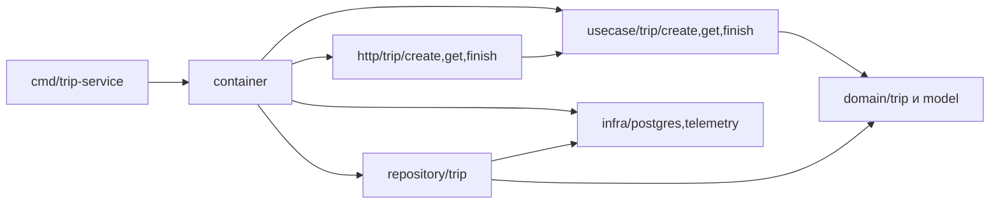

# TripGo — лабораторные работы №1 и №2

TripGo — HTTP-сервис поездок из курса «Разработка микросервисов на Go».
В первой лабораторной реализованы создание, получение и завершение поездки,
PostgreSQL-репозитории, миграции и контекстный менеджер транзакций.
Во второй работе добавлены слои, gomock-тесты, интеграционные проверки,
golangci-lint и OpenTelemetry.

Подробный разбор второй работы и ответы для защиты находятся в
[LAB2_DOCUMENTATION.md](LAB2_DOCUMENTATION.md).

## Требования

- Go 1.26 или новее;
- утилита `tripgoctl` из
  [course-infra](https://github.com/course-go-autumn-2026/course-infra);
- GNU Make;
- golangci-lint v2.15.0 для `make lint`;
- C-компилятор для `go test -race`;
- Docker — для сборки и запуска контейнера.

## Быстрый старт

```bash
tripgoctl cluster start
tripgoctl environment start
tripgoctl connect

make migrate
make run
```

`tripgoctl environment start` читает корневой
[`environment.toml`](environment.toml) и создаёт локальный `.env`. Makefile
сначала загружает безопасные значения из `.env.example`, затем адреса окружения
из `.env`. Значения из окружения shell имеют приоритет над обоими файлами, а
аргументы вида `make run SHUTDOWN_TIMEOUT=2s` — над всеми источниками. Сервис по
умолчанию доступен на `http://localhost:8080`.

Проверка:

```bash
curl -sS -X POST http://localhost:8080/api/v1/trips \
  -H 'Content-Type: application/json' \
  -d '{
    "user_id": "5cb72c04-7650-45c9-a79b-bcdba0631e0c",
    "driver_id": "8860b315-ec86-42eb-a17c-7c163d721ff5",
    "start_point": {"latitude": 59.9398, "longitude": 30.3146},
    "end_point": {"latitude": 59.9290, "longitude": 30.3626},
    "price": 1450
  }'

curl -sS http://localhost:8080/health
curl -sS http://localhost:8080/ready
```

## Команды

| Команда | Назначение |
|---|---|
| `make generate` | сгенерировать OpenAPI-код и gomock-моки |
| `make migrate` | применить все миграции |
| `make migrate-down` | откатить последнюю миграцию |
| `make run` | запустить сервис |
| `make build` | проверить сборку всех пакетов |
| `make docker-build` | собрать образ `trip-service:lab2` |
| `make test` | unit-тесты с `-race -count=2`, покрытие в терминале и `coverage.out` |
| `make test-integration` | PostgreSQL-тесты с `-race -count=2` |
| `make lint` | golangci-lint, проверка слоёв и форматирования |

## Переменные окружения

Полный пример находится в [`.env.example`](.env.example).

| Переменная | Назначение |
|---|---|
| `HTTP_ADDR` | адрес HTTP-сервера |
| `HTTP_READ_TIMEOUT` | максимальное время чтения запроса |
| `HTTP_READ_HEADER_TIMEOUT` | максимальное время чтения заголовков |
| `HTTP_WRITE_TIMEOUT` | максимальное время записи ответа |
| `HTTP_IDLE_TIMEOUT` | таймаут keep-alive соединения |
| `LOG_LEVEL` | уровень JSON-логов: debug, info, warn или error |
| `SHUTDOWN_TIMEOUT` | общий бюджет graceful shutdown |
| `DATABASE_URL` | DSN PostgreSQL |
| `DATABASE_MAX_CONNS` | максимальный размер пула |
| `DATABASE_MIN_CONNS` | минимальный размер пула |
| `DATABASE_MAX_CONN_LIFETIME` | максимальное время жизни соединения |
| `DATABASE_CONNECT_TIMEOUT` | таймаут подключения и стартового Ping |
| `DATABASE_QUERY_TIMEOUT` | таймаут запроса и транзакции |

Переменные HTTP и PostgreSQL обязательны. При пропущенном или некорректном значении сервис
завершается на старте с понятной ошибкой.

## HTTP API

| Метод | Путь | Назначение |
|---|---|---|
| `POST` | `/api/v1/trips` | создать поездку |
| `GET` | `/api/v1/trips/{tripId}` | получить поездку |
| `POST` | `/api/v1/trips/{tripId}/finish` | завершить поездку |
| `GET` | `/health` | проверить, что процесс жив |
| `GET` | `/ready` | проверить доступность PostgreSQL |

Успешные ответы имеют `Content-Type: application/json`. Ошибки возвращаются в
формате RFC 9457 с `Content-Type: application/problem+json` и стабильным полем
`code`.

## Принятые решения

### Запрет двух активных поездок

Инвариант закреплён частичным уникальным индексом:

```sql
CREATE UNIQUE INDEX trips_one_active_per_driver_idx
    ON trips (driver_id)
    WHERE status = 'active';
```

Поэтому два конкурентных `POST /api/v1/trips` для одного водителя не могут
создать две активные поездки. Ошибка PostgreSQL `23505` по этому индексу
преобразуется в доменную ошибку `driver_busy` и HTTP `409`.

### Идемпотентное создание поездки

Клиент может передать UUID в заголовке `Idempotency-Key`. Ключ действует 24
часа. Сервис хранит в PostgreSQL SHA-256 нормализованного тела запроса, `trip_id`
и время истечения ключа.

Первый запрос резервирует ключ и создаёт поездку в одной транзакции. Повтор с
тем же ключом и телом возвращает ту же поездку с HTTP `200`; с другим телом —
`409 idempotency_conflict`. Без заголовка создание работает как обычно и
возвращает `201`.

Резервирование выполняется до вставки поездки. Внешний ключ на заранее
сгенерированный `trip_id` объявлен `DEFERRABLE INITIALLY DEFERRED`, поэтому он
проверяется при commit. Параллельные запросы с одним ключом блокируются на его
уникальном индексе: один создаёт поездку, остальные после commit читают её и не
создают дубликаты. Перед резервированием нового ключа сервис удаляет все истёкшие
записи по индексу `expires_at`.

### Менеджер транзакций

`TxManager.Do` открывает транзакцию, помещает её в `context.Context` и
вызывает бизнес-функцию с новым контекстом. Репозиторий сам выбирает исполнитель:
транзакцию из контекста либо обычный пул. Поэтому бизнес-код не импортирует
`pgx` и не передаёт транзакции аргументами.

При `nil` выполняется commit, при ошибке или panic — rollback. Вложенный
`Do` переиспользует текущую транзакцию. Создание поездки и начальная запись
`trip_status_history` выполняются атомарно.

Использован уровень изоляции `READ COMMITTED`: он достаточен, поскольку
конкурентный запрет активных поездок обеспечивает уникальный индекс, а
завершение защищено условным атомарным
`UPDATE ... WHERE status = 'active'`. Более строгая изоляция добавила бы
конфликты и повторы без дополнительной гарантии для этих операций.

### Конкурентное завершение

Завершение меняет только строку со статусом `active` и возвращает её через
`RETURNING`. При двух одновременных запросах обновление выполнит только один.
Второй запрос увидит уже завершённую поездку и получит `409 trip_completed`;
`finished_at` не перезаписывается.

### Health и readiness

`/health` не обращается к базе и сообщает только о жизни процесса. `/ready`
выполняет `Ping` PostgreSQL с таймаутом и возвращает `503`, если сервис пока
не способен обслуживать запросы.

## Docker

Образ собирается в два этапа. В builder-слое компилируется статический Go-бинарь
с `CGO_ENABLED=0`; в итоговый слой `distroless/static-debian12:nonroot` копируется
только бинарь. Процесс запускается как `nonroot:nonroot`. В образе нет исходного
кода, Go toolchain, кеша сборки и shell.

`.dockerignore` исключает `.git`, тесты, `.env`, `.tripgo`, настройки IDE и
локальные материалы.

Сборка:

```bash
make docker-build
```

PostgreSQL сначала запускается через `tripgoctl`, миграции применяются с хоста:

```bash
tripgoctl environment start
make migrate
```

В Docker Desktop для macOS и Windows адрес `localhost` из `.env` заменяется на
специальное имя хоста `host.docker.internal`:

```bash
DATABASE_URL="$(sed -n 's/^DATABASE_URL=//p' .env)"

docker run --rm -p 8080:8080 \
  --env-file .env.example \
  --env-file .env \
  --env "DATABASE_URL=${DATABASE_URL/localhost/host.docker.internal}" \
  trip-service:lab2
```

В Linux с обычным Docker Engine имя `host.docker.internal` по умолчанию не
резолвится. Контейнер можно запустить в сети хоста: тогда PostgreSQL окружения
доступен по исходному адресу `localhost`, а подменять `DATABASE_URL` не нужно:

```bash
docker run --rm --network host \
  --env-file .env.example \
  --env-file .env \
  trip-service:lab2
```

С `--network host` публиковать порт через `-p` не требуется: сервис слушает
порт `8080` непосредственно на хосте.

Проверка контейнера:

```bash
curl -i http://localhost:8080/ready
```


## Архитектура



`main` читает конфигурацию, вызывает `container.New`, запускает сервис и
обрабатывает сигнал завершения. `container` — единственная точка сборки production
зависимостей, включая пул, менеджер транзакций, репозитории, usecase и хендлеры.
Сохранено имя `cmd/trip-service` из первой работы для существующих команд запуска.

У каждого действия свой пакет транспорта и usecase. Неэкспортируемые интерфейсы
в `contract.go` принадлежат потребителю. Usecase знает необходимые методы
репозитория, менеджера транзакций и наблюдателя бизнес-событий. HTTP знает
интерфейс usecase. Реализации связываются вручную в контейнере. `model.Trip` и
`model.Coordinates` — алиасы доменных типов для обмена между слоями.

`domain/trip` проверяет UUID, координаты, цену и переход `Finish`.
`http/domainerror` содержит единый маппинг ошибок в RFC 9457 Problem. Для
неизвестной ошибки клиент получает `internal_error` с безопасным описанием,
а исходная причина попадает в журнал запроса. `depguard` закрепляет запреты
зависимостей из задания, включая импорт инфраструктуры в транспорт.

Создание и завершение работают внутри `TxManager.Do`. Завершение сначала
применяет доменное правило, затем выполняет условный
`UPDATE ... WHERE status = 'active'`. Гонка двух завершений даёт один успех и
один `trip_completed`. Счётчики и бизнес-логи записываются после commit.
Повтор по `Idempotency-Key` не увеличивает число созданных поездок.

## Проверки второй работы

```bash
go install github.com/golangci/golangci-lint/v2/cmd/golangci-lint@v2.15.0
# Добавить $(go env GOPATH)/bin в PATH.
make generate
make lint
make test

tripgoctl environment start
tripgoctl connect
make test-integration
```

`make test-integration` требует доступный `DATABASE_URL` из `.env`. Каждый тест
создаёт отдельную схему с уникальным именем, применяет три исходные миграции и
удаляет схему при завершении. Проверяются сохранение и чтение, занятый водитель,
повторное завершение, отсутствующая поездка, полный откат записей в двух
таблицах при настоящем нарушении CHECK, rollback после отмены и panic,
параллельные создания, завершения и повторы ключа идемпотентности.

Unit-зависимости мокируются через `gomock`, а `mocks_test.go` генерируются
через `go:generate` рядом с потребителем. Порог задания 50% относится к домену
и usecase. `make test` печатает покрытие всех пакетов, включая сгенерированный
код и точку сборки приложения.

## Наблюдаемость

`environment.toml` использует `lab = 2` и компоненты `postgres`, `observability`.
Адреса PostgreSQL и OTLP берутся из `.env`, ссылки на UI — из `tripgoctl connect`.

| Переменная | Значение из `.env.example` |
|---|---|
| `OTEL_SERVICE_NAME` | `trip-service` |
| `OTEL_RESOURCE_ATTRIBUTES` | `service.namespace=tripgo,deployment.environment=local` |
| `OTEL_EXPORTER_OTLP_ENDPOINT` | `http://localhost:4318`, заменяется окружением |
| `OTEL_EXPORTER_OTLP_PROTOCOL` | `http/protobuf`, также поддерживается `grpc` |
| `OTEL_TRACES_SAMPLER` | `parentbased_always_on` |
| `OTEL_TRACES_SAMPLER_ARG` | необязательный аргумент sampler |
| `OTEL_EXPORTER_OTLP_TIMEOUT` | `3000`, миллисекунды |
| `OTEL_BSP_EXPORT_TIMEOUT` | `3000`, миллисекунды |
| `OTEL_METRIC_EXPORT_INTERVAL` | `5000`, миллисекунды |
| `OTEL_METRIC_EXPORT_TIMEOUT` | `3000`, миллисекунды |

Провайдеры SDK передаются зависимостями. Единственный SDK-wide hook — обработчик
внутренних ошибок OTel, направляющий их в JSON slog. Resource включает версию
сборки. Используется W3C TraceContext. Асинхронный экспорт позволяет продолжать
обслуживание при недоступном коллекторе. При остановке HTTP сначала завершается,
затем сбрасываются сигналы телеметрии и закрывается PostgreSQL.

Цепочка HTTP — `Recover → Tracing → Logging → Metrics → router`.
Ответ буферизуется, поэтому panic после частичной записи заменяет тело
на `500 internal_error`. На запрос записывается один `request handled` с
шаблоном маршрута, статусом, временем и `trace_id`/`span_id`. Для panic дополнительно
пишется stack trace. Создание и завершение имеют отдельные бизнес-события.

На пуле стоит `otelpgx` с дополнением атрибутов таблицы и метрик в
`infra/postgres`. SQL-параметры в спаны не попадают. Репозитории не зависят от OTel.
Для текущих запросов распознаются три таблицы сервиса. В атрибутах HTTP только
шаблоны маршрутов, что ограничивает число временных рядов.

Экспортируются `http.server.request.duration` (histogram, секунды),
`http.server.active_requests` (up-down counter),
`db.client.operation.duration` (histogram, секунды),
`tripgo.trips.created` и `tripgo.trips.completed` (counter).
Дополнительно из `docs/observability.md` курса реализован `tripgo.trips.active`
(observable gauge, актуальное число активных поездок в PostgreSQL).

Для проверки отправьте создание, чтение и завершение поездки из примера выше,
найдите трейс `POST /api/v1/trips` в Jaeger, затем найдите тот же `trace_id`
в JSON-логе. В Grafana Explore выберите Prometheus и запросите
`http_server_request_duration_seconds_count`, `tripgo_trips_created_total`,
`db_client_operation_duration_seconds_count`. Перцентили доступны через
`histogram_quantile` и ряды с суффиксом `_bucket`.

Материалы для описания PR и скриншоты находятся в [docs/lab2](docs/lab2/README.md).
