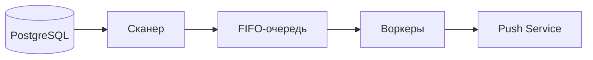

# TripGo

TripGo — учебный HTTP-сервис на Go. Он создаёт и завершает поездки, хранит
координаты водителя в PostgreSQL и отдаёт маршрут. Если по активной поездке
давно не было координат, сервис просит устройство прислать новую точку через
Push Service. Это основная задача лабораторной № 3.

## Запуск

Понадобятся Go 1.26 или новее, Docker, GNU Make и утилита `tripgoctl` из
[course-infra](https://github.com/course-go-autumn-2026/course-infra).

Из корня репозитория поднимите окружение и примените миграции.

```bash
tripgoctl cluster start
tripgoctl environment start
make migrate
make run
```

Команда `tripgoctl environment start` поднимет PostgreSQL, Push Service и
инструменты наблюдаемости, а адреса запишет в локальный `.env`. Посмотреть эти
адреса и ссылки на Grafana и Jaeger можно командой `tripgoctl connect`.

В другом терминале проверьте, что сервис подключился к базе.

```bash
curl -fsS http://localhost:8080/ready
```

## Проверка координат и пушей

Создайте поездку. Для следующих команд подставьте поле `id` из ответа в `TRIP_ID`.

```bash
curl -fsS -X POST http://localhost:8080/api/v1/trips \
  -H 'Content-Type: application/json' \
  -d '{
    "user_id": "5cb72c04-7650-45c9-a79b-bcdba0631e0c",
    "driver_id": "8860b315-ec86-42eb-a17c-7c163d721ff5",
    "start_point": {"latitude": 59.9398, "longitude": 30.3146},
    "end_point": {"latitude": 59.9290, "longitude": 30.3626},
    "price": 1450
  }'
```

Отправьте координату с текущим временем и прочитайте маршрут.

```bash
TRIP_ID='вставьте UUID из ответа'
ROUTE="http://localhost:8080/api/v1/trips/$TRIP_ID/positions"

curl -fsS -X POST "$ROUTE" -H 'Content-Type: application/json' --data-binary @- <<JSON
{
  "coordinates": {"latitude": 59.935, "longitude": 30.335},
  "recorded_at": "$(date -u +%FT%TZ)"
}
JSON

curl -fsS "$ROUTE"
```

Прекратите отправлять координаты. При настройках по умолчанию точка устареет
через минуту, и на одном из следующих тиков в логах Push Service появится
`REQUEST_POSITION` для водителя этой поездки.

```bash
tripgoctl environment logs push-service
```

Завершите поездку, чтобы остановить опрос и снова использовать того же водителя
в примере.

```bash
curl -fsS -X POST "http://localhost:8080/api/v1/trips/$TRIP_ID/finish"
```

## Опрос устаревших поездок



Сканер по таймеру одним SQL-запросом выбирает активные поездки, у которых давно
не было координат. Если точек ещё нет, он отсчитывает время от начала поездки.
В очередь первыми идут поездки, по которым координат нет дольше всего. Под эту
выборку есть частичный индекс.

В очереди и в работе может быть только одна задача на поездку. Если очередь
заполнена, сканер записывает предупреждение, увеличивает счётчик `dropped` и
переходит к следующей поездке. Если точка так и не пришла, поездка снова попадёт
в выборку на следующем тике.

Сервис записывает точку и обновляет `last_position_at` в одной транзакции.
Опоздавшая точка остаётся в маршруте, а отметка хранит время самой свежей точки.
После успешной записи сервис отменяет ожидающий пуш по этой поездке.

При остановке сервис дожидается текущих HTTP-запросов, останавливает сканер и
даёт воркерам доработать очередь в пределах общего таймаута. Затем закрывает
соединения с Push Service и PostgreSQL. После перезапуска сканер снова берёт
устаревшие поездки из базы.

| Переменная | По умолчанию | Что меняет |
|---|---|---|
| `POSITION_CHECK_INTERVAL` | `30s` | Как часто сканер проверяет поездки |
| `POSITION_STALE_AFTER` | `60s` | Через сколько времени точка устаревает |
| `POSITION_WORKERS` | `4` | Сколько воркеров отправляют пуши |
| `POSITION_QUEUE_SIZE` | `100` | Сколько задач может ждать в очереди |
| `PUSH_HTTP_URL` | Из `.env` окружения | Куда отправлять запросы Push Service |
| `PUSH_REQUEST_TIMEOUT` | `1s` | Сколько ждать ответа на один запрос |
| `SHUTDOWN_TIMEOUT` | `10s` | Общий бюджет остановки |

Полный список настроек есть в [`.env.example`](.env.example). При запуске через
Make значения из `.env` перекрывают пример. Затем идут переменные shell и
аргументы Make. Например, `make run POSITION_CHECK_INTERVAL=10s` меняет период
сканирования для одного запуска.

## HTTP API

| Метод и путь | Что делает |
|---|---|
| `POST /api/v1/trips` | Создаёт поездку |
| `GET /api/v1/trips/{tripId}` | Возвращает поездку |
| `POST /api/v1/trips/{tripId}/finish` | Завершает поездку |
| `POST /api/v1/trips/{tripId}/positions` | Сохраняет точку активной поездки |
| `GET /api/v1/trips/{tripId}/positions` | Возвращает точки по времени записи, при совпадении времени — по `id` |
| `GET /health` | Проверяет, что процесс жив |
| `GET /ready` | Проверяет соединение с PostgreSQL, при ошибке возвращает `503` |

У водителя может быть одна активная поездка. Если передать `Idempotency-Key`
при создании, в течение 24 часов повтор с тем же ключом и телом вернёт исходную
поездку. Ошибки приходят в формате `application/problem+json` с
машиночитаемым полем `code`. Форматы запросов и ответов описаны в
[OpenAPI-контракте](contracts/openapi/trip-service.openapi.yaml).

## Тесты и метрики

```bash
make test
make test-integration
make lint
```

Для тестов с `-race` нужен C-компилятор, для интеграционных тестов — доступный
PostgreSQL, для линтера — `golangci-lint` v2.15.0. Тесты проверяют запись и
сортировку координат, откат транзакции, переполнение очереди, отмену задачи и
остановку воркеров. Команда `make generate` обновляет OpenAPI-код и gomock-моки.

В Grafana смотрите размер очереди (`tripgo_position_requests_queue_size`),
занятость воркеров (`tripgo_position_requests_workers_active`) и счётчик
`tripgo_stale_checks_total` с результатами `queued`, `duplicate` и `dropped`.
В Jaeger спан обработки `positions.request` связан со сканированием
`positions.scan` через span link. Вызов Push Service виден отдельным HTTP-спаном.

Результаты проверок, план запроса PostgreSQL и графики нагрузки собраны в
[отчёте по ЛР № 3](docs/lab3/README.md). Разбор слоёв и идемпотентного создания
поездки есть в [документации ЛР № 2](LAB2_DOCUMENTATION.md).

## Запуск в Docker

Сначала поднимите окружение и выполните `make migrate` с хоста. Команда
`make docker-build` соберёт образ `trip-service:lab3`.

На Linux с Docker Engine можно использовать сеть хоста.

```bash
docker run --rm --network host --env-file .env.example --env-file .env trip-service:lab3
```

В Docker Desktop опубликуйте порт 8080 и укажите `host.docker.internal` как хост
в `DATABASE_URL`, `PUSH_HTTP_URL` и `OTEL_EXPORTER_OTLP_ENDPOINT`.

```bash
host_endpoint() {
  sed -n "s/^$1=//p" .env |
    sed -E 's#(//|@)(localhost|127\.0\.0\.1):#\1host.docker.internal:#'
}

docker run --rm -p 8080:8080 --env-file .env.example --env-file .env \
  -e "DATABASE_URL=$(host_endpoint DATABASE_URL)" \
  -e "PUSH_HTTP_URL=$(host_endpoint PUSH_HTTP_URL)" \
  -e "OTEL_EXPORTER_OTLP_ENDPOINT=$(host_endpoint OTEL_EXPORTER_OTLP_ENDPOINT)" \
  trip-service:lab3
```
