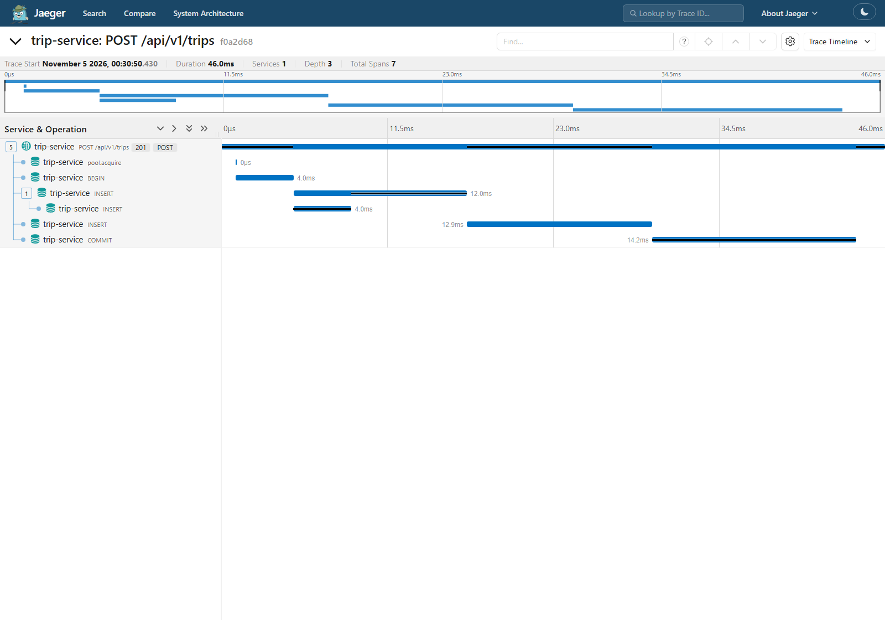
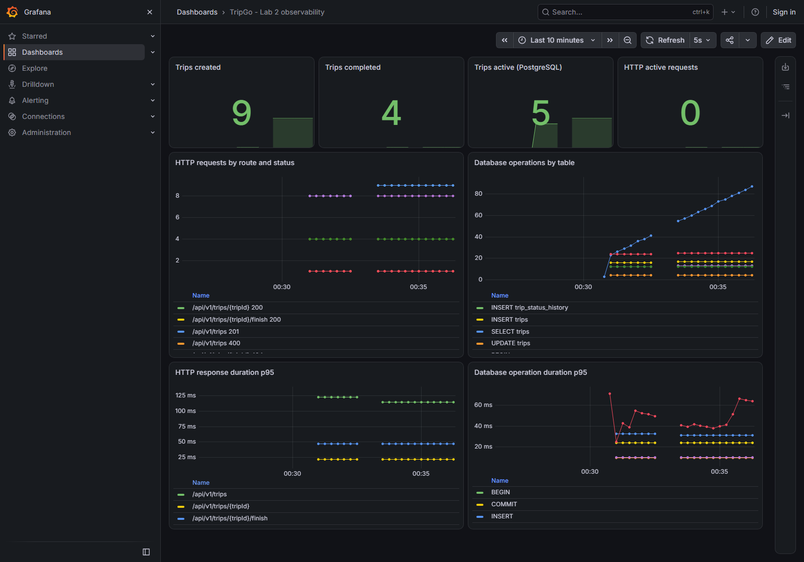

# Лабораторная работа 2

Материалы для PR из ветки `homework/02` в `main`.

## Изменения

Сервис первой работы разделён на домен, модели, отдельные usecase и HTTP-хендлеры
создания, получения и завершения поездки, репозитории и инфраструктуру. Сборка
зависимостей выполняется в `internal/container`, вызываемом из `main`.
Интерфейсы находятся в `contract.go` потребителя. Схема слоёв приведена в README.

В домен перенесены валидация и переход `Finish`, ошибки преобразуются в Problem
в `http/domainerror`. Сохранены идемпотентное создание, частичный уникальный индекс
занятого водителя и условное завершение с защитой от конкуренции.

Добавлены generated gomock-моки, unit-тесты и изолированные PostgreSQL-тесты,
golangci-lint с depguard, JSON slog, HTTP/pgx-трейсы, метрики и OTLP-экспорт.

## Решения

- Имя `cmd/trip-service` сохранено для команд и Dockerfile первой работы.
- `container` служит единственной точкой сборки production зависимостей.
- `model.Trip` и `model.Coordinates` — алиасы домена, правила модели определены один раз.
- Пул и менеджер транзакций находятся в `infra/postgres`, репозиторий выбирает
  транзакцию из контекста. SQL и миграции первой работы продолжают использоваться.
- `otelpgx` инструментирует пул. Обёртка в infra добавляет имя таблицы и
  гистограмму с нужными атрибутами, не передавая телеметрию в репозиторий.
- HTTP-ответ буферизуется для восстановления после panic даже после частичной записи.
- Бизнес-счётчики и события записываются после commit. Идемпотентный повтор не
  считается новой поездкой. Active gauge читает фактическое состояние PostgreSQL.
- Стандартные OTEL env управляют экспортом и сэмплированием. Провайдеры передаются
  явно. SDK-wide error handler направляет ошибки фонового экспорта в JSON slog.

## Проверено 5 ноября 2026

| Проверка | Результат |
|---|---|
| `make lint` | 0 issues, golangci-lint 2.15.0 |
| `make test` | успешно, `-race -count=2` |
| `domain/trip` | 88,9% |
| `usecase/trip/create` | 97,7% |
| `usecase/trip/get`, `usecase/trip/finish` | 100% |
| `http/domainerror` | 100% |
| `make test-integration` | 11 сценариев, каждый дважды, настоящий PostgreSQL |
| HTTP через запущенный сервис | 201, 200, 400, 404, 409 |
| Collector replicas=0 | создание 201 и чтение 200, процесс продолжает работать |
| Ошибка экспорта | JSON slog с `level=ERROR`, `service=trip-service` |
| Восстановление коллектора | rollout завершён, replicas=1 |
| Docker `trip-service:lab2` | сборка успешна, `/ready` 200, SIGTERM завершает с кодом 0 |

Интеграционные сценарии проверяют в том числе настоящий CHECK failure после
записи в обе таблицы и отсутствие обеих записей после rollback, отмену контекста,
panic, одновременные создания и завершения, конкурентные повторы ключа.

## Задание со звёздочкой

Gremlins нашёл два случая, в которых тесты пропускали изменения границ
координат. После добавления проверок выживших мутаций в автоматическом
прогоне не осталось. Разбор всех случаев и результаты до и после сохранены
в [отчёте о мутационном тестировании](mutation/README.md).

## Скриншоты

Запрос `POST /api/v1/trips`, trace ID `f0a2d686431fa55859a10f338f47907e`.
В Jaeger видны HTTP-спан, BEGIN, INSERT поездки, INSERT истории и COMMIT.
Тот же trace ID присутствует в логе `request handled`, статус 201.

```json
{"level":"INFO","msg":"request handled","trace_id":"f0a2d686431fa55859a10f338f47907e","span_id":"6052440243484da9","service":"trip-service","method":"POST","route":"/api/v1/trips","status":201,"duration_ms":46.0174}
```



Grafana показывает созданные, завершённые и активные поездки, количество
HTTP-запросов по шаблону маршрута и статусу, обращения к БД и p95 длительности.



Ссылки на UI нужно получать через `tripgoctl connect`. На машине проверки
Jaeger доступен на порту 22686, Grafana — на 22300, Prometheus — на 22909.
