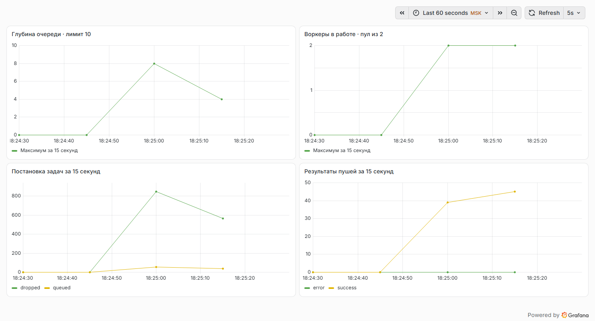

# Лабораторная работа №3

Материалы для PR из ветки `homework/03` в `main`.

## Изменения

- POST сохраняет координату и атомарно обновляет `last_position_at` через
  `TxManager`. GET возвращает маршрут в порядке `recorded_at, id`.
- Один сканер выбирает устаревшие активные поездки. Ограниченная FIFO-очередь
  дедуплицирует задачи, а фиксированный пул запрашивает координаты через Push Service.
- При успешной записи координаты ожидающий пуш отменяется. При переполнении
  сканер пропускает постановку, и поездка может снова попасть в выборку на следующем тике.
- При завершении сначала останавливается HTTP-сервер, затем сканер. Воркеры
  обрабатывают оставшуюся очередь в пределах общего таймаута.

## План запроса

PostgreSQL 16, 12 000 поездок, из них 100 активных и 25 устаревших. План получен
с настройками планировщика по умолчанию. Для воспроизведения примените миграции
к отдельной пустой БД и выполните [explain.sql](explain.sql) через `psql`.
Скрипт откатывает тестовые данные.

```text
Index Scan using trips_active_last_seen_idx on trips  (cost=0.15..74.20 rows=33 width=40) (actual time=0.017..0.022 rows=25 loops=1)
  Index Cond: (COALESCE(last_position_at, started_at) < (CURRENT_TIMESTAMP - '00:01:00'::interval))
  Buffers: shared hit=2
Planning:
  Buffers: shared hit=72
Planning Time: 5.983 ms
Execution Time: 0.063 ms
```

## Проверки

- `make generate`, `make lint`, `make test` и `make test-integration` прошли.
  Тесты запускаются дважды с `-race`. В пакете фонового опроса утечки горутин
  проверяет `goleak`.
- Миграции применились до версии 5, откатились до версии 3 и применились повторно.
- На запущенном сервисе проверены ответы HTTP 201, 200, 400, 404 и 409,
  сортировка маршрута и сохранение `last_position_at` при опоздавшей координате.
- Пока по поездке поступали свежие координаты, Push Service не получал команд
  по её водителю. Когда координаты перестали поступать, заглушка приняла
  `REQUEST_POSITION`.
- При задержке Push Service 5 секунд запросы воркеров завершались по таймауту
  1 секунда, а `/ready` отвечал 200. Под нагрузкой процесс завершился после
  SIGTERM за 3,39 секунды при бюджете 10 секунд. В логах порядок остановки
  виден как HTTP-сервер → сканер → воркеры.
- После перезапуска сервис снова отправлял `REQUEST_POSITION` по активным
  поездкам из PostgreSQL без повторной загрузки тестовых данных.
- В Jaeger спан `positions.request` связан с `positions.scan` через
  `FOLLOWS_FROM`. HTTP-спан `POST /api/v1/push` является дочерним для воркера.

## Метрики под нагрузкой

200 устаревших активных поездок, очередь на 10 задач, 2 воркера. Сканер
запускался каждые 4 секунды, задержка стандартной заглушки Push Service
составляла 550 мс. В Grafana видны заполнение очереди, занятость воркеров,
успешные пуши и рост `dropped` при переполнении.


